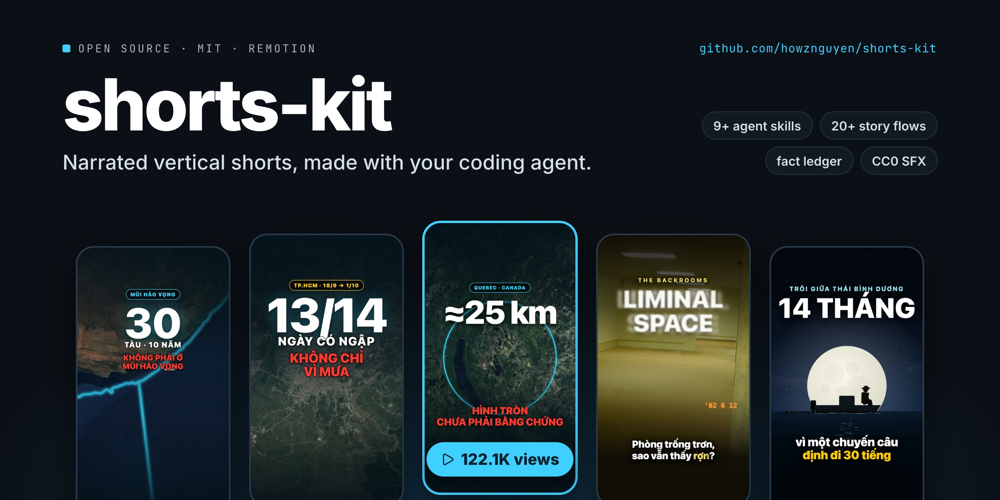
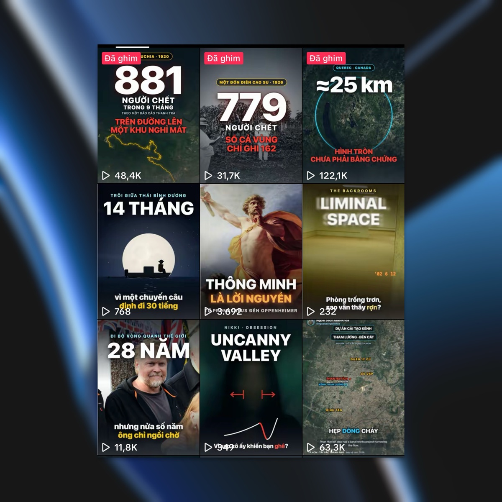
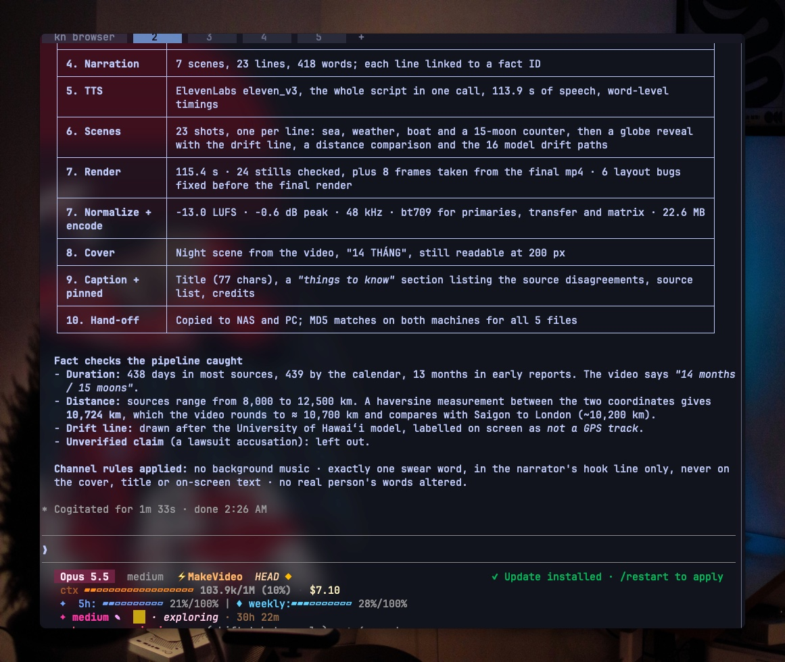
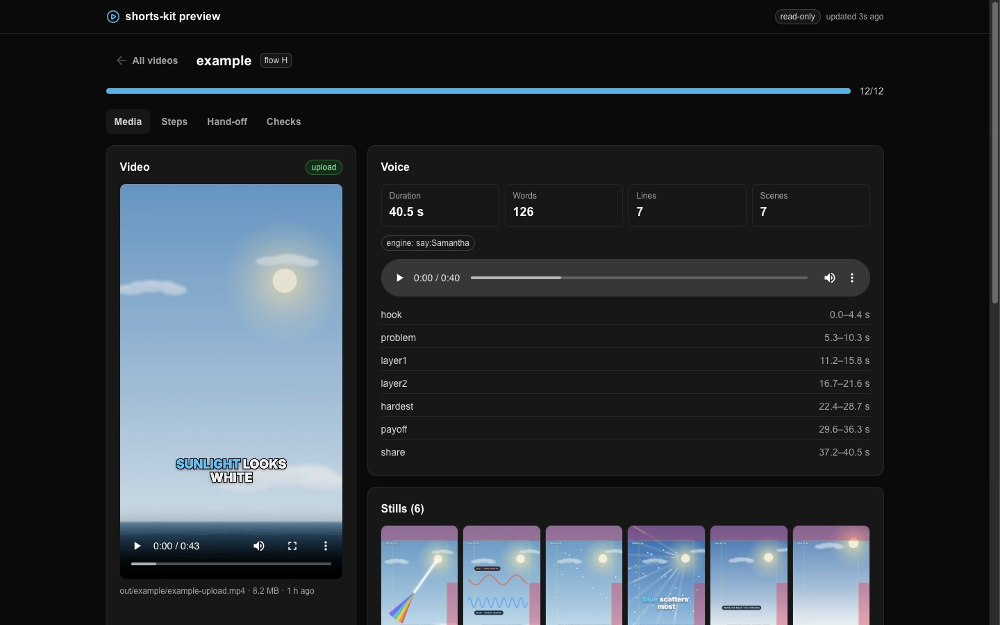

# shorts-kit



Make narrated vertical shorts (TikTok, YouTube Shorts, Reels) with a coding agent and
[Remotion](https://www.remotion.dev).

You talk to your agent ("make a video about why the sky is blue"). The agent follows
the kit's skills step by step: facts first, a storytelling flow, the script, the voice,
the scenes, stills to check, the render, the cover and the caption. You review, then you
upload the file yourself. The kit never posts anything.

The rules and skills come from a private pipeline that took a new knowledge channel from
zero to about 120k views on its best video in two months. Every rule keeps the reason it
exists, because most of them were written after a published video broke it. They are
defaults: change them for your own channel.

## Results

The channel these rules came from, two months in. The best videos and the flops sit side
by side on purpose: topics close to the audience carried it (tens of thousands of views),
topics that drifted from the channel's niche got a few hundred. The kit cannot pick your
topic for you.



What a finished run reports, from the original private pipeline (it also copied files to
a NAS and applied that channel's own swearing rule; neither is part of this kit):



## What is in the box

- **9 agent skills** (`.claude/skills/sk-*`), started by `sk-pipeline`. They work in
  Claude Code, and in any agent that reads `AGENTS.md` (Codex, OpenCode, ...).
- **SOUL.md**: your channel's rulebook. Voice, sentence style, writing for a
  text-to-speech voice, safe zones, captions, audio, facts, covers, hand-off. Each rule
  is tagged `[measured]`, `[default]`, `[craft]` or `[hard]` so you know how freely to
  change it.
- **20 storytelling flows** (`docs/flows/`): Three reasons, Trace back, Explain it,
  Reading a graph, Empty world with a late reveal, and more. Each has beats, when to use
  it and its traps.
- **A fact ledger** (`docs/facts/`). No sentence goes into a script before its claim
  has a verified record, and the linter enforces it.
- **A Remotion library** (`src/shared/`): word-timed captions, kinetic type, safe-zone
  overlay, music bed and SFX, camera moves, and an illustrated world (sky, sea, sun,
  moon, stars, clouds, rain, birds, people, fish).
- **8 CC0 sound effects** generated by the kit (`public/sfx/`), and a guide to using
  them ([docs/sfx.md](docs/sfx.md)).
- **Scripts** for every step, from TTS with word timestamps to a platform-ready encode.
- **A local dashboard** (`bun run preview`) showing each video's progress, the render,
  the stills, the cover at profile-grid size, and the caption ready to copy.



## Requirements

- [Bun](https://bun.sh) 1.3 or later
- [ffmpeg](https://ffmpeg.org) and ffprobe on your `PATH`
- A coding agent: [Claude Code](https://claude.com/claude-code), Codex, OpenCode, ...
- A voice, one of:
  - `say` (built into macOS): free and offline. The example uses it.
  - [ElevenLabs](https://elevenlabs.io): much better quality, needs an API key.
  - `edge` (Microsoft Edge online voices): free, but the service sometimes stops
    answering. Do not rely on it.

Install the tools:

```bash
# macOS
brew install bun ffmpeg

# Linux
curl -fsSL https://bun.sh/install | bash
sudo apt install ffmpeg

# Windows (PowerShell)
powershell -c "irm bun.sh/install.ps1 | iex"
winget install ffmpeg
```

## Install

```bash
git clone https://github.com/howznguyen/shorts-kit.git
cd shorts-kit
bun install
```

For ElevenLabs, copy `.env.example` to `.env` and set `ELEVENLABS_API_KEY`.

## Check that it works

Build the example video ("Why is the sky blue?", about 43 s) from start to finish. On
macOS this needs no key and no network except for fonts:

```bash
bun run tts example        # voice + word timestamps
bun run lint example       # machine checks: 0 errors expected
bun run render example     # out/example/example.mp4
bun run cover example      # out/example/example-cover.png
bun run normalize example  # loudness to -13 LUFS
bun run encode example     # out/example/example-upload.mp4, ready to upload
bun run preview            # open http://127.0.0.1:7788
```

On Linux or Windows there is no `say`: set `"engine": "elevenlabs"` in
`src/videos/example/narration.json` first.

## Make your own channel

Open your agent in the repo and say:

> set up the kit for my channel

`sk-improve` asks about your niche, language, platform, voice, tone and video length,
then edits `SOUL.md` and `docs/soul/thresholds.json` to match, and logs every change.

Then:

> make a video about <your topic>

`sk-pipeline` takes it from there. It tells you where it is and what it needs from you:
mostly approving the script, listening to the voice, and looking at stills.

## Commands

| Command | What it does |
| --- | --- |
| `bun run new <id> --flow <A..T>` | scaffold `src/videos/<id>/` from a flow's beats |
| `bun run dev <id>` | Remotion Studio for that video |
| `bun run tts <id> [--force]` | synthesise the whole script, write the audio and `voice.json` |
| `bun run lint <id>` | style, facts, length and timing checks from `thresholds.json` |
| `bun run facts` | validate the fact ledger |
| `bun run still <id> --frame=N [--safe]` | one frame to `out/<id>/`, with the safe-zone overlay if `--safe` |
| `bun run render <id>` | `out/<id>/<id>.mp4` |
| `bun run cover <id>` | `out/<id>/<id>-cover.png` and `.jpg` |
| `bun run normalize <id>` | loudness to target, `out/<id>/<id>-loud.mp4` |
| `bun run encode <id>` | yuv420p, BT.709, 48 kHz, faststart: `out/<id>/<id>-upload.mp4` |
| `bun run preview [--lan]` | local dashboard; `--lan` adds a token so a phone on your Wi-Fi can open it |
| `bun run check` | import boundaries and type check |
| `bun run dev gallery` | browse every shared component |

## Layout

```
SOUL.md                 your channel's rules (start here)
AGENTS.md, CLAUDE.md    agent entrypoint: invoke sk-pipeline first
.claude/skills/         sk-pipeline, sk-brief, sk-facts, sk-narration, sk-style,
                        sk-scene, sk-render, sk-handoff, sk-improve
docs/soul/              one file per rule section, plus thresholds.json
docs/flows/             20 storytelling flows
docs/visuals/           7 visual types
docs/facts/             the fact ledger
docs/lessons/           why videos get zero views; how to measure your niche's style
briefs/                 one brief per video
src/shared/             the Remotion library, grouped by kind
src/videos/<id>/        one video: its own entry, narration.json, voice.json
scripts/                every command above
public/sfx/             CC0 sound effects
out/<id>/               hand-off files (not committed)
```

Each video has its own Remotion entry, so a broken video never breaks another one, and
`bun run check` stops a video from importing another video.

## What you still do yourself

- Pick the topic. Topic choice moves views more than anything in this kit.
- Approve the script and listen to the voice once, end to end.
- Look at the stills and the render. The agent catches layout bugs, not dull videos.
- Upload, set the cover, and paste the pinned comment (it carries the credits).
- After posting, give your agent the numbers so `sk-improve` can adjust your rules.

## Licences

The kit is MIT. The sound effects are CC0, generated by the kit. Fonts come from Google
Fonts (Inter, SIL Open Font License). The preview UI uses
[Untitled UI React](https://github.com/untitleduico/react) free components (MIT, notice
in `scripts/preview/ui/LICENSE-untitledui.md`). No music is included: see
`public/music/README.md` before you add any.

Images in `docs/assets/` (README only, not part of the kit): the covers are from the
author's own channel. Satellite imagery in three of them: EOxCloudless
https://cloudless.eox.at by EOX IT Services GmbH (Contains modified Copernicus Sentinel
data 2016), released under the Creative Commons Attribution 4.0 International License.
The Backrooms photo (2002) is from Wikimedia Commons, "Copyrighted free use".

## Author

Made by [howznguyen](https://howznguyen.dev) · [github.com/howznguyen](https://github.com/howznguyen)
